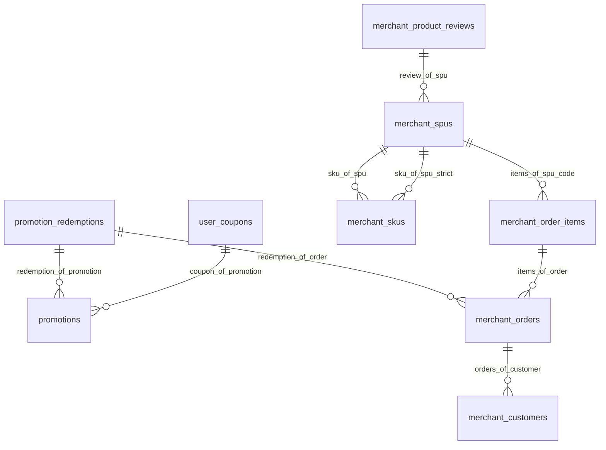

# 本体知识层 · 知识地图(GENERATED)

> 手改无效 —— 再生成:仓库根执行 `services/.venv/bin/python ontology/registry.py --write-all`;
> 漂移门:`ontology/tests/test_codegen_sync.py`。决策全文见[ADR-0015](../../docs/adr/0015-ontology-knowledge-layer.md)。

三条分层裁定:平台级一份本体(租户差异留 tenant_configs)· 业务数据留 PG · 商城/后台 = faces 曝光面。

## 词汇闭集(core.yaml)

- **领域**:`product`(商品域), `trading`(交易域), `marketing`(营销域), `crm`(用户域), `shared`(共享面(thread_notes/owner_mappings 等无四域归属的表))
- **库路由**:`merchant_db`(商户真账库 agent_merchant), `engine_db`(平台库 agent_platform)
- **曝光面**:`customer`(顾客面(线程属主绑定)), `operator`(坐席/员工面(员工 JWT)), `staff_review`(员工代行批驳面(live_desk:approve)), `spi`(SPI 三方面(HMAC 签名))

## 实体(四域 + 共享面)

### crm(用户域)

| 实体 | 物理表 | 库 | 别名 | 列 |
|---|---|---|---|---|
| merchant_customers | `merchant_customers` | merchant_db | `c` | `id`、`customer_id`、`name`、`phone`、`member_level`、`created_at` |

### marketing(营销域)

| 实体 | 物理表 | 库 | 别名 | 列 |
|---|---|---|---|---|
| promotions | `promotions` | merchant_db | `p` | `id`、`name` |
| promotion_redemptions | `promotion_redemptions` | merchant_db | `rd` | `promotion_id`、`order_id`、`discount_amount`、`created_at` |
| user_coupons | `user_coupons` | merchant_db | `uc` | `user_id`、`promotion_id`、`status`、`claimed_at`、`used_at` |

### product(商品域)

| 实体 | 物理表 | 库 | 别名 | 列 |
|---|---|---|---|---|
| merchant_spus | `merchant_spus` | merchant_db | `s` | `id`、`spu_code`、`title`、`category`、`brand`、`status` |
| merchant_skus | `merchant_skus` | merchant_db | `k` | `id`、`spu_id`、`price`、`stock` |
| merchant_product_reviews | `merchant_product_reviews` | merchant_db | `r` | `id`、`spu_id`、`rating`、`content`、`created_at` |

### shared(共享面(thread_notes/owner_mappings 等无四域归属的表))

| 实体 | 物理表 | 库 | 别名 | 列 |
|---|---|---|---|---|
| merchant_audit_logs | `merchant_audit_logs` | merchant_db | `al` | `id`、`action_type`、`order_id`、`operator`、`created_at` |
| session_metrics | `session_metrics` | engine_db | `sm` | `business_id`、`resolution_status`、`created_at` |
| after_sale_tickets | `after_sale_tickets` | engine_db | `t` | `business_id`、`status`、`created_at` |

### trading(交易域)

| 实体 | 物理表 | 库 | 别名 | 列 |
|---|---|---|---|---|
| merchant_orders | `merchant_orders` | merchant_db | `o` | `order_id`、`customer_id`、`status`、`total_amount`、`created_at` |
| merchant_order_items | `merchant_order_items` | merchant_db | `oi` | `order_id`、`spu_id`、`quantity`、`price`、`cost_at_purchase` |

## 实体关系(Mermaid ER)

## 动作面(application/actions.yaml)

| 动作 | 面 | 权限锚 | 需工单 | 说明 |
|---|---|---|---|---|
| `approve` | `customer`、`staff_review`、`spi` | `live_desk:approve` | 是 | 审批通过 |
| `reject` | `customer`、`staff_review`、`spi` | `live_desk:approve` | 是 | 审批驳回 |
| `cancel` | `customer`、`spi` | — | 是 | 取消工单 |
| `start_human_takeover` | `customer`、`spi` | — | 否 | 呼叫人工接管 |
| `human_message` | `operator`、`spi` | — | 是 | 坐席发言(不结束) |
| `human_finish` | `operator`、`spi` | — | 是 | 坐席结案 |
| `release_takeover` | `operator`、`spi` | — | 否 | 释放人工接管 |
| `human_reply` | `spi` | — | 是 | 人工回复(SPI 旧通道) |

冻结面已知差异(幽灵,后端不受理):`reply`。

## 资金闸缺省

- 免签退款限额缺省 = **50**(六处分叉单源,收紧方向;租户级显式覆写 nike=150 / adidas=120 通道不变)。
